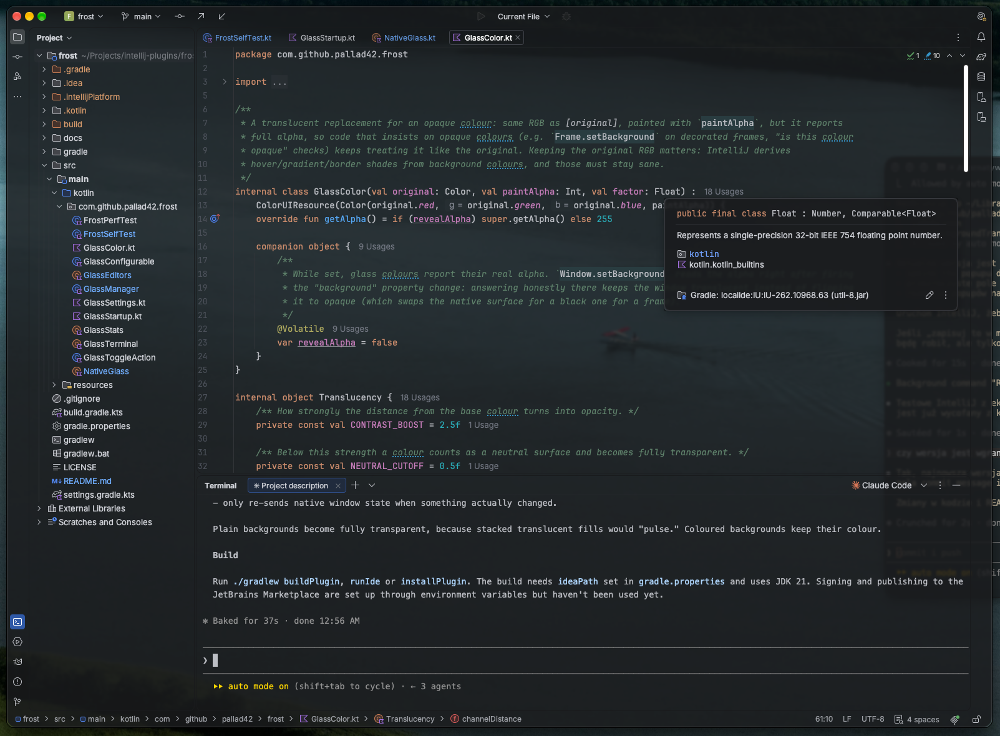
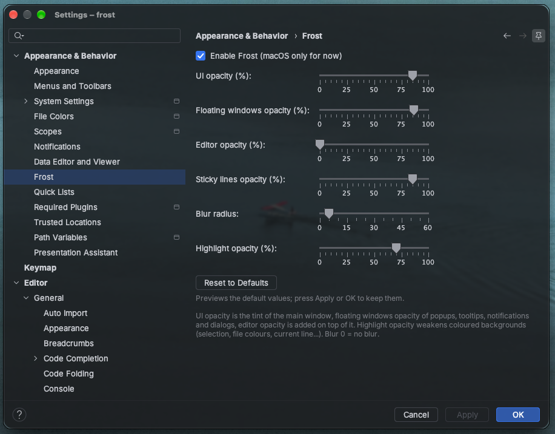

<p align="center">
  
</p>

<h1 align="center">Frost</h1>

<p align="center">
  <b>Frosted glass for your JetBrains IDE.</b><br>
  Translucent, blurred IDE windows - like <code>background-opacity</code> and <code>background-blur</code> in Ghostty.
</p>

<p align="center">
  <a href="#install">Install</a> ·
  <a href="#settings">Settings</a> ·
  <a href="#faq">FAQ</a> ·
  <a href="#how-it-works">How it works</a>
</p>

<p align="center">
  
  
  <a href="LICENSE"></a>
  
</p>

<p align="center">
  <b>Early access:</b> tested on macOS with IntelliJ IDEA 2026.2.
  Something looks off or stays solid? Please <a href="https://github.com/pallad42/frost/issues">open an issue</a>.
</p>

<p align="center">
  
</p>
<p align="center">
  <sub>Wallpaper: <a href="https://unsplash.com/photos/aerial-photography-of-body-of-water-surrounded-by-trees-p8hnTQOyzfU">aerial photography of a body of water surrounded by trees</a> by Jeremy Bishop on Unsplash</sub>
</p>

<!-- Demo recording goes here:
<p align="center">
  
</p>
-->

## Features

- **The whole IDE turns to glass** - main window, tool windows, toolbars, status bar, popups, tooltips,
  notifications and dialogs.
- **Real blur, rendered by macOS.** The window server blurs whatever is behind the IDE, the same way Ghostty does it.
- **Colours stay readable.** Selection, current line, file colours, search results and terminal output keep their
  hue, just translucent. Popups and notifications stay solid enough to read.
- **Light and dark themes.** Works with both, including switching theme while the IDE is running.
- **No flicker.** Translucent Swing windows normally flash black or blank; Frost works around every cause it found.
- **Tune it live.** Sliders for every layer, with instant preview and Reset to Defaults.

## Install

**From disk** (until it is on JetBrains Marketplace):

1. Download `frost-<version>.zip` from Releases, or build it with `./gradlew buildPlugin`.
2. <kbd>Settings</kbd> → <kbd>Plugins</kbd> → <kbd>⚙</kbd> → <kbd>Install Plugin from Disk…</kbd>
3. Restart the IDE.

Quick toggle at any time: <kbd>View</kbd> → <kbd>Frost</kbd>.

## Settings

<kbd>Settings</kbd> → <kbd>Appearance & Behavior</kbd> → <kbd>Frost</kbd>. Every change previews live; Cancel reverts.

<p align="center">
  
  <br>
  <sub>The Frost settings page</sub>
</p>

| Setting | Default | What it does |
|---|---|---|
| UI opacity | 85% | Tint of the main window |
| Floating windows opacity | 95% | Popups, tooltips, notifications, dialogs, Settings |
| Editor opacity | 0% | Extra editor background on top of the tint |
| Sticky lines opacity | 85% | Background of sticky lines over scrolling code |
| Blur radius | 5 | Blur of what is behind the main window, 0 = off |
| Floating windows blur radius | 5 | Blur behind popups, dialogs, Settings, 0 = off |
| Highlight opacity | 70% | Strength of coloured backgrounds |

## FAQ

<details>
<summary><b>Does it work on Windows or Linux?</b></summary>

Not yet. The blur and window translucency are macOS-specific; on other systems the plugin does nothing.
Windows (Acrylic/Mica) and Linux (KDE blur) are possible future targets.
</details>

<details>
<summary><b>The IDE looks too transparent or flickers.</b></summary>

Turn off <kbd>Appearance</kbd> → <kbd>Background Image</kbd>. The IDE's background image feature also rewrites
backgrounds and fights with Frost.
</details>

<details>
<summary><b>Why is the Markdown preview not transparent?</b></summary>

The preview is rendered by an embedded browser (JCEF) that paints its own opaque page background, which plugins
cannot change. The Markdown source editor next to it is translucent as usual.
</details>

<details>
<summary><b>The project colour gradient in the toolbar ends with a hard edge.</b></summary>

With <kbd>Appearance</kbd> → <b>Use project colors in main toolbar</b>, the IDE paints that gradient partly from
pre-rendered, fixed-size textures without transparency, so it cannot fade out into the glass. Turn the option off
for a clean frosted toolbar.
</details>

<details>
<summary><b>Scrolling feels slightly slower on a big maximised window.</b></summary>

A translucent window has to be composited by macOS together with everything behind it, on every frame; the cost
grows with the window size and the blur radius. Lowering <b>Blur radius</b> (or setting it to 0) helps the most.
</details>

## How it works

<details>
<summary>The details, for the curious</summary>

- The window peer is made per-pixel translucent; the native NSWindow gets a single tint on its Metal layer and a
  window-server blur (`CGSSetWindowBackgroundBlurRadius`, the same call Ghostty uses).
- Every background colour - theme, components, editor colour schemes, terminal output - is replaced by a
  translucent version: neutral surfaces become fully transparent (stacked translucent fills would pulse), coloured
  ones keep their hue.
- Overlays drawn inside the window (notifications, hints, balloons, sticky lines) get a near-solid background,
  since there is no blur under them.
- Flicker fixes: `Window.paint` would wipe the whole window first (JDK-8303950), so the window keeps reporting itself
  opaque to Swing while its peer stays translucent; theme-change bursts are coalesced; native state is only re-sent
  when it really changed; loading-layer snapshots without alpha are skipped.
</details>

## Build

```
./gradlew buildPlugin      # build/distributions/frost-<version>.zip
./gradlew runIde           # sandbox IDE with the plugin
./gradlew installPlugin    # install into your IDE (close it first)
./gradlew verifyPlugin     # compatibility check
```

Requires the local IDE path in `gradle.properties` (`ideaPath`); Gradle provisions JDK 21 automatically.

## Contributing

Issues and pull requests are welcome. Found flicker, a part of the UI that stays solid, or something that looks off
with your theme? Open an issue - a screenshot or a short screen recording helps a lot. Windows and Linux support
would be a great contribution too.

## Credits

Built with the help of Claude (Anthropic) - design, testing and the flicker hunting were a joint effort.

## License

MIT - see [LICENSE](LICENSE).
